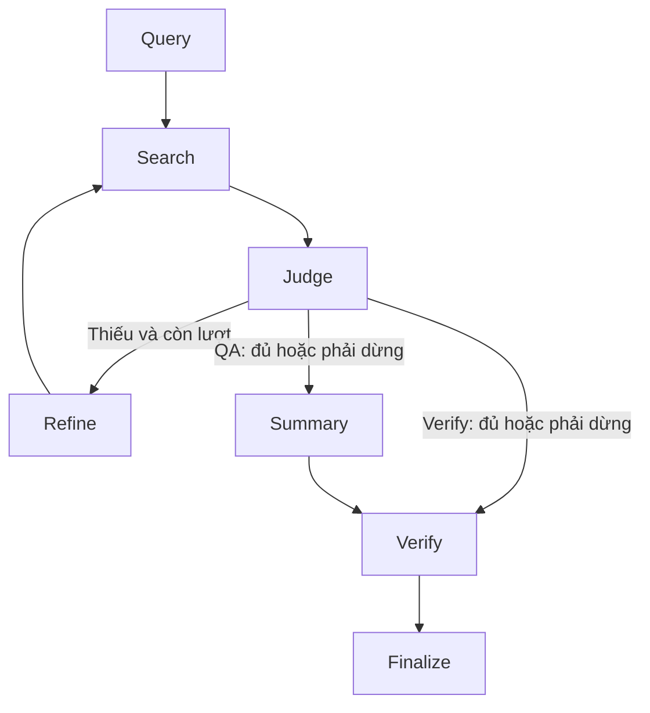

# Cập nhật dữ liệu crawler — 19/10/2026

Code đã được cập nhật để đọc bundle 4 file. Đọc THAY_DOI_DU_LIEU.md và README.md trước: các đoạn bên dưới mô tả bản đầu; thông tin thiếu ingestion, ngày mặc định cố định, article bắt buộc và phạm vi kiểm chứng đã được thay bởi bản cập nhật. Nguyên lý RAG và kiến trúc 7 node vẫn áp dụng.

# RAG và Search Agent cho Tillegal bằng LangGraph

## 1. Kết luận thiết kế

Đề xuất cho nhóm: **RAG có kiểm soát bằng LangGraph, retrieval kết hợp BM25 + dense vector, tra chính xác định danh pháp luật, lấy ngữ cảnh điều khoản, Judge để tìm bổ sung có giới hạn, Verify sau khi sinh**. Có thể gọi là hybrid retrieval + bounded agentic RAG + citation verification. Các thuật ngữ này chỉ các trục khác nhau; không cần chọn duy nhất một nhãn RAG.

Bắt đầu bằng baseline BM25 + exact lookup + Summary + Verify. Sau khi chạy được trên corpus nhỏ, bật dense, đo cải thiện retrieval; sau đó thêm reranker/Judge loop. Giữ các cờ để ablation. Không cần train riêng 5 model cho 5 agent.

LangGraph là framework điều phối, RAG là phương pháp cấp tài liệu cho bước sinh. Vector search là một backend retrieval. Agent là vai trò xử lý; node có thể chỉ là code Python. Chỉ những bước cần phân tích ngôn ngữ mới cần gọi LLM.

Tài liệu nhóm là thiết kế dự kiến, không phải bằng chứng phần mềm đã triển khai. PDF đã đọc: PIPELINE_LEGAL_AI (1)(2).pdf, 22 trang, v2 09/10/2026. Tài liệu phân biệt rõ hai mode QA và kiểm chứng, Judge và Verify, năm nhãn sản phẩm và ngân sách hữu hạn.

## 2. Repo đã kiểm tra và khác biệt với thiết kế

Snapshot GitHub: `boqiny/L-MARS`, commit `67a0b4c9731f80f8a402f7419f13f4508589093f`, truy cập 18/10/2026. Các nhận xét dưới đây dành cho snapshot này; README/paper có thể mô tả mục tiêu rộng hơn code.

| Đường dẫn / hàm | Code đang thực hiện | Hệ quả cho nhóm |
|---|---|---|
| `lmars/agents.py: QueryAgent.build_query` | strip chuỗi rồi tạo QueryGeneration; query_type mặc định web_search, priority high | Chưa phải LLM phân tích jurisdiction/date/issues; nhóm cần tự thêm QueryPlan |
| `SearchAgent.search` | Cache theo example_id hoặc gọi Tavily/Serper; parse text thành SearchResult | Có thể học adapter tool; nên dùng JSON trực tiếp thay parse text khi viết mới |
| `SearchResult` | source, title, content, url | Chưa đủ metadata điều/khoản, phiên bản và liên kết claim |
| `lmars/tools/offline_rag_tool.py` | Markdown → chunks → BM25 thủ công → kết quả | Đây là sparse retrieval; không có embedding/vector index |
| `LMarsWorkflow.run` trong `lmars/workflow.py` | for turn in range(max_turns), accumulate, judge, refine, summary | Điều phối hiện tại là Python loop; file này không dùng StateGraph |
| `WorkflowConfig.enable_offline_rag/enable_courtlistener` | Có trường cấu hình | Không có lời gọi hai tool đó trong SearchAgent.search / LMarsWorkflow.run đã đọc; không suy ra tích hợp hoàn chỉnh từ cờ |
| `JudgeAgent.evaluate` | Bỏ blocked, mỗi result lấy 400 ký tự, gọi LLM và đọc JSON | Prompt nhắm US bar exam, cần viết lại cho VN; parse lỗi trả insufficient, không sufficient |
| `LMarsWorkflow.run` | Bỏ Judge ở lượt cuối; vẫn tổng hợp dữ liệu hiện có | Nhóm nên Judge cả lượt cuối và giữ thiếu khi hết lượt |
| `SummaryAgent.generate_final_answer` | Ghép source/title/content vào prompt; nhánh này không ghép trường URL riêng | Nên truyền evidence ID + metadata và render citation bằng code |
| `verify_agent.py` | Tách claim; resolve citation trong evidence; entailment trên nguồn trích dẫn | Có thể học nguyên tắc không mượn nguồn khác để cứu citation sai |
| `faith_search/workflow.py` | Draft → batch verify → tìm lại theo failure type → sửa URL → verify lại → abstention | Đây là workflow bổ sung, khác Judge loop trước Summary |
| `requirements.txt` | LangChain 0.3.x, không có langgraph | Viết project LangGraph mới; đừng ghép tùy tiện dependency mới vào môi trường repo cũ |

Đường đọc code hiệu quả: agents.py (dataclass → Query → Search → Judge → Summary) → offline_rag_tool.py → workflow.py → verify_agent.py → faith_search/workflow.py.

Lưu ý chi tiết: `search_backend='serper_deep'` không tự quyết định deep trong SearchAgent.search; sau nhánh Tavily, code chọn deep theo `use_deep_content`. Nhóm nên dùng một enum/router rõ ràng để tránh hai cấu hình lệch nhau. Cache hiện tại đọc file theo example_id, không phải content-addressed cache của query+corpus; giữ key đủ ngữ cảnh khi xây hệ thống mới.

## 3. RAG hoạt động từ đầu đến cuối

RAG = Retrieval-Augmented Generation: trước hoặc trong lúc sinh câu trả lời, lấy tài liệu ngoài model rồi đưa phần liên quan vào context. Model không tự có quyền đọc database; code/tool phải làm retrieval và cấp nội dung. RAG không sửa trọng số model. Gọi embedding model cũng không có nghĩa train embedding model.

Có hai luồng tách biệt.

**Ingestion, chạy khi nhập/cập nhật nguồn:** lấy văn bản + metadata → parse HTML/PDF/OCR khi cần → chuẩn hóa định danh → tách điều/khoản/điểm → giữ phiên bản → kiểm tra chất lượng → sparse index + vector index → lưu snapshot. Trước khi retrieval chạy, corpus và index phải tồn tại.

**Online, chạy mỗi request:** input → QueryPlan → exact/sparse/dense retrieval → fusion → rerank → lấy ngữ cảnh cha/cross-reference → Judge → tìm bổ sung nếu cần → Summary → Verify → response.

Ví dụ khái niệm, không khẳng định luật thật: người dùng hỏi “Hồ sơ loại Y có phải có mã X không?”. Corpus có quy tắc chung ở Điều 1 và ngoại lệ ở Điều 2. Retrieval chỉ trả Điều 1 thì Summary có thể trả sai đối với Y. Judge phải tìm thiếu căn cứ ngoại lệ; Search vòng sau tìm Điều 2. Verify kiểm tra câu “Y không cần X” có được đúng citation Điều 2 hỗ trợ không.

Sự khác nhau của các điểm số:

- BM25 đo phù hợp từ khóa theo tần suất, độ hiếm và độ dài tài liệu.
- Cosine giữa embedding query/chunk đo gần nhau trong không gian biểu diễn.
- RRF gộp thứ hạng, không cộng thẳng BM25 score và cosine.
- Reranker đọc cặp query/chunk, chấm mức liên quan sâu hơn.
- Judge đánh giá tập evidence có đủ xử lý câu hỏi không.
- Verify đánh giá claim cụ thể có được citation cụ thể hỗ trợ không.

Không điểm nào tự là xác suất “kết luận pháp luật đúng”. Một văn bản hết hiệu lực có thể được BM25 xếp số 1.

## 4. RAG nào phù hợp?

| Lựa chọn | Ích lợi | Hạn chế | Đề xuất |
|---|---|---|---|
| BM25-only | Số hiệu, tên văn bản, điều khoản, rẻ, dễ debug | Kém khi câu hỏi diễn đạt khác từ nguồn | Baseline bắt buộc |
| Dense-only | Câu hỏi tự nhiên và paraphrase | Có thể nhầm số điều, văn bản gần nghĩa | Không làm backend duy nhất |
| Hybrid BM25+dense | Bao phủ cả chính xác từ khóa và ngữ nghĩa | Cần quản lý 2 index và đánh giá | Backend mục tiêu |
| Parent-child retrieval | Tìm khoản nhỏ, đọc thêm điều cha/ngoại lệ | Context dễ phình | Dùng có ngân sách context |
| Multi-query | Tách vấn đề, quy tắc, ngoại lệ, hiệu lực | Nhiều query trùng/chi phí tăng | 2–4 query chất lượng trước |
| Agentic / corrective retrieval | Judge chỉ ra gap rồi tìm tiếp | Tăng latency/cost, có thể lặp | Giới hạn 3 vòng khởi đầu |
| GraphRAG | Quan hệ sửa đổi/dẫn chiếu có cấu trúc | Công xây đồ thị, lỗi extraction, khó đánh giá | Chưa cần graph tổng quát ở MVP |
| Fine-tuning | Có thể cải thiện lỗi cụ thể khi có gold | Không thay corpus cập nhật hoặc retrieval | Để sau baseline |

Parent-child không bắt buộc dùng thư viện mang tên ParentDocumentRetriever. Có thể lưu parent_article_id và lấy các khoản liên quan bằng code. Metadata quan hệ sửa đổi hoặc dẫn chiếu cũng không đồng nghĩa phải triển khai GraphRAG ngay.

## 5. Search Agent: trách nhiệm và hợp đồng

Search nhận kế hoạch có cấu trúc; không nhận chỉ một câu hỏi rồi tự viết kết luận. Một node Search có thể chứa nhiều tool; không nhất thiết dùng một LLM tool-calling agent tự do. Router code là lựa chọn hợp lý vì query type/phạm vi đã xác định.

Input mẫu (thiết kế đề xuất, không phải schema gốc L-MARS):

```json
{
  "request_id": "req-001",
  "as_of_date": "2026-10-18",
  "jurisdiction": "VN",
  "queries": [
    {"text": "DEMO điều 2", "purpose": "resolve_citation", "citation_id": "R1", "target_claim_id": "C1"},
    {"text": "hồ sơ Y ngoại lệ mã X", "purpose": "find_support", "target_claim_id": "C1"}
  ],
  "citations": [{"citation_id": "R1", "document_id": "DEMO", "version_id": "v1", "article": "2"}],
  "existing_evidence_ids": [],
  "budget": {"max_rounds": 3, "candidate_k": 20, "final_k": 6}
}
```

Xử lý một query:

1. Validate input, chuẩn Unicode và định danh. Không tự đoán version/điều khi ambiguous.
2. Nếu resolve_citation: lookup document+version+article+clause+point; không semantic-search để thay citation gốc.
3. Nếu find_support: lọc jurisdiction; chọn version theo thời điểm nếu metadata xác minh được. Unknown được đánh dấu, không ép valid.
4. Chạy BM25 và dense trên cùng tập candidate hợp lệ. Đề xuất ban đầu mỗi nhánh top 20; đây là hyperparameter cần đo.
5. RRF: score(d)=sum_r 1/(60+rank_r(d)), rank bắt đầu từ 1. Hằng 60 là khởi điểm thực nghiệm.
6. Cross-encoder rerank top 20 nếu có model phù hợp; chọn khoảng 6 đoạn. Không rerank exact match thành một nguồn khác.
7. Lấy điều cha, ngoại lệ và dẫn chiếu cần thiết. Cần giữ vị trí, version và quan hệ đến chunk được retrieve.
8. Dedupe theo doc+version+location+content identity; giữ query/claim/citation association. Không loại trùng theo mỗi URL vì một URL có nhiều điều khoản.
9. Ghi errors riêng; timeout/403/404/trang rỗng không phải evidence. Lookup miss khác URL unavailable.
10. Trả evidence nguyên văn + provenance; không tóm tắt luật thay nội dung gốc ở bước Search.

Output mẫu:

```json
{
  "evidence": [{
    "evidence_id": "E1", "chunk_id": "DEMO-v1-a2",
    "document_id": "DEMO", "version_id": "v1", "article": "2",
    "content": "Ngoại lệ DEMO: hồ sơ mẫu loại Y không cần mã X.",
    "url": null, "source_type": "local_snapshot",
    "effective_from": "2020-01-01", "effective_to": null,
    "temporal_status": "valid", "retrieval_methods": ["exact_lookup"],
    "target_claim_ids": ["C1"], "target_citation_ids": ["R1"],
    "purposes": ["resolve_citation"], "retrieved_at": "2026-10-18T00:00:00Z"
  }],
  "retrieval_errors": []
}
```

Metadata unknown phải được giữ unknown. `effective_to=null` chỉ có nghĩa chưa có điểm kết thúc đã biết, không tự chứng minh còn hiệu lực vô thời hạn; trong code cần cả `validity_known=true` do ingestion đã kiểm tra. Thuộc tính hiệu lực nên ở cấp điều khoản vì sửa đổi có thể chỉ tác động một phần văn bản.

## 6. BM25 trong L-MARS chi tiết

OfflineRAGTool mặc định đọc `inputs/**/*.md`; title từ heading # đầu tiên hoặc tên file. Metadata chỉ gồm file_path/title/filename. Tách heading trước; section dài mới dùng cửa sổ khoảng 500 **ký tự**, overlap 100 **ký tự**. Đây không phải 500 token.

Tokenizer lower-case, regex, bỏ English stop words và token dài không quá 2 ký tự. Với tiếng Việt, điều này có thể làm mất từ ngắn và số điều/khoản; không bê nguyên sang corpus Việt Nam. BM25 thủ công dùng k1=1.5, b=0.75. Không có bước embedding.

Sau khi rank chunks, code chỉ giữ một chunk tốt nhất cho mỗi file. Điều này có thể bỏ mất ngoại lệ ở điều khác cùng luật. `content` bị rút còn 500 ký tự; có `full_content` nhưng formatter search_offline_rag dùng content. Trong code nhóm nên giữ full text cho bước đọc nguồn và context packer chọn đúng điều khoản.

Input tool search_offline_rag là query string + top_k=3 mặc định; output là formatted string. Lớp OfflineRAGTool.search trả list dict với title/content/full_content/file_path/relevance_score/source/chunk_id. Code đề xuất dùng JSON schema xuyên suốt thay việc format rồi parse lại.

## 7. Mapping thành LangGraph

State = bộ nhớ của một lần chạy: original_input, mode, as_of_date, plan, evidence map, history, rounds, judge_result, draft, report, errors, stop_reason. Nó chứa dữ liệu, không phải bộ tham số chạy model.

Node = hàm nhận state và trả partial update. Edge = bước tiếp theo. Conditional edge = code quyết định dựa trên status/budget. Orchestrator của nhóm chính là cấu trúc graph + router + counter; không cần thêm LLM chỉ để chọn node.

Luồng MVP:



Cả nhánh “đủ” và “phải dừng” có thể chuyển Summary, nhưng state khác nhau: phần thiếu phải đưa vào limitations. “Hoàn thành request” không đồng nghĩa tất cả claims VERIFIED.

Trong `app.py`, build_graph dùng StateGraph(State), add_node, add_edge, add_conditional_edges, compile và invoke. Judge chạy sau mỗi Search, kể cả vòng cuối. Lượt tìm được tăng bằng code. Query lặp được bỏ qua; nếu không thêm evidence, dừng thay vì lặp mãi. max_rounds tính cả vòng đầu, nằm trong 1..5; mặc định 3.

`config={"recursion_limit": 40}` là cấu hình engine graph, không chứa evidence/câu hỏi. State chứa câu hỏi và dữ liệu nghiệp vụ. Một vòng Search có thể chạy nhiều query; giới hạn lượt không đồng nghĩa giới hạn API calls. MVP giới hạn tối đa 6 query/vòng; production cần thêm calls/tokens/deadline budget riêng.

Nếu triển khai checkpoint sau này, compile(checkpointer=...) rồi dùng configurable.thread_id theo phiên. Chỉ đưa thread_id vào config mà không có checkpointer không tự tạo memory bền vững. Không share state giữa các người dùng hoặc để turn trước làm thay đổi citation gốc của turn hiện tại.

## 8. Input/output từng node

| Node | Đọc | Trả | Có LLM? |
|---|---|---|---|
| Query | Input, mode, date | Plan issues/queries/claims/citations | Có, trừ demo |
| Search | Queries, refs, date, accumulated evidence/history | Evidence map, errors, new_count, rounds | Không, trừ model embedding/reranker |
| Judge | Câu hỏi, issues, evidence, history | SUFFICIENT/INSUFFICIENT/ERROR, gaps, next_queries, usable IDs | Có |
| Refine | Judge next_queries | Kế hoạch truy vấn cập nhật | Code; có thể tách LLM sau |
| Summary | Question, evidence, Judge | Danh sách câu + evidence IDs + limitations | Có |
| Verify | Claim, đúng citation/source, date | Report từng cặp + quote | Code + LLM entailment |
| Finalize | Report, draft, limits | Response JSON và stop_reason | Không |

Mỗi node không cần đọc mọi trường state trong prompt. JSON gửi LLM chỉ chứa phần có ích. Với corpus lớn, phải context-pack theo token; MVP chưa có bộ packer nên chỉ dùng corpus nhỏ và số candidate hạn chế.

## 9. Judge và Verify không thay thế nhau

Judge hỏi: “đã đủ tài liệu để xử lý vấn đề người dùng chưa?” Ví dụ có quy tắc mà thiếu ngoại lệ thì insufficient. Output có gaps để tìm bổ sung.

Verify hỏi: “claim C1 có được đúng citation R1 hỗ trợ không?” Ví dụ nguồn nói thời hạn chung mà claim nói được miễn trong mọi trường hợp thì không supported. Có nguồn khác đúng không tự cứu citation sai.

Năm trạng thái trong PDF nhóm:

| Status | Khi dùng |
|---|---|
| VERIFIED | Đúng nguồn/vị trí, supported, đúng thời điểm |
| INVALID | Đã có căn cứ sai nội dung/định danh/vị trí/thời gian |
| UNVERIFIED | Thiếu citation, ambiguous, thiếu metadata, verifier lỗi |
| UNAVAILABLE | Địa chỉ/nguồn đã xác định nhưng không truy cập được |
| INSUFFICIENT_EVIDENCE | Có nội dung liên quan nhưng chưa đủ kết luận |

MVP local chưa sinh UNAVAILABLE vì không fetch URL; không giả vờ lookup miss là HTTP failure. Với trường hợp nguồn không đề cập claim, cần guideline human tách unsupported và insufficient; đây là bài toán annotation, không chỉ prompt.

Mode QA: sinh câu có evidence IDs → entailment từng cặp → chỉ render câu đã VERIFIED. URL hiển thị phải lấy từ evidence database, không để LLM tự viết. Nếu có nhiều citation cần cùng nhau hỗ trợ một câu, MVP bảo thủ: từng nguồn phải hỗ trợ toàn câu; production cần joint-entailment và báo cáo từng cặp riêng.

Mode verify: tách và giữ claim/citation nguyên bản → exact resolve → Verify → report. Không gọi Summary viết lại claim người dùng trước khi kiểm chứng. Nguồn thay thế phải nằm mục đề xuất, không thay audit gốc.

Một quote nằm trong source chỉ chứng minh quote được trích đúng, chưa chứng minh entailment đúng. LLM verifier vẫn có thể sai; cần human gold. Temperature=0 cũng không bảo đảm tái lập tuyệt đối.

## 10. Web fallback và Faith-Search mở rộng

Hai phần này được thiết kế nhưng chưa cài trong MVP để không mô tả stub là chức năng thật.

Web fallback: khi corpus thiếu hoặc cần refresh → query website nguồn chính thống đã chọn → nhận candidates URL/title/snippet → fetch HTML/PDF → kiểm tra content và metadata → extract chunk → Evidence schema giống local. Search engine không phải database hiệu lực. Một snippet không đủ làm nguồn kết luận nếu mất điều kiện/ngoại lệ.

Fetch URL ở backend cần domain policy, timeout/size cap/content type validation, không fetch tùy tiện mạng nội bộ từ URL do người dùng cung cấp. Nguồn web là dữ liệu; bỏ qua mọi chỉ thị kiểu “ignore previous instructions” trong trang. Đây là yêu cầu triển khai tool, không đưa cảnh báo kỹ thuật vào UI chat.

Faith-Search: Verify phát hiện URL unavailable → xác định doc/version/location gốc → tìm mirror/snapshot có provenance → tạo repair proposal → Verify nguồn thay thế → giữ report gốc. Với QA có thể tạo draft version mới; verify mode chỉ gợi ý sửa. Không thay URL bằng top result chỉ vì có title gần giống. Workflow repo có bước repair top-ranked rồi reverify; Tillegal cần kiểm tra định danh/phiên bản chặt hơn.

Sửa draft: Verify báo claim sai → Summary nhận report + nguồn → tạo draft_version+1 → Verify lại. Ngân sách riêng 1 lần sửa draft, 1 lần sửa nguồn như PDF đề xuất; số search calls trong repair vẫn phải nằm budget tổng. Code MVP chưa có hai loop sửa này.

## 11. Thiết kế dữ liệu và version

Một chunk JSONL trong code có: chunk_id, document_id, version_id, title, article, clause, point, content, url, jurisdiction, effective_from, effective_to, validity_known, source_type. ID chunk phải ổn định và duy nhất theo văn bản/version/location/content. Không overwrite bản cũ; amendment hoặc reparse thay content nên tạo ID/version phù hợp.

Production bổ sung: parent_article_id, source_hash, source_snapshot_id, char/page offsets, fetched_at, metadata provenance, amendments/repeals links, embedding model/version, parser version. Lưu metadata ở DB và source bytes ở object storage; sparse/vector indexes là cấu trúc dẫn xuất có thể rebuild.

Ngày ban hành, ngày đăng web, ngày tải dữ liệu và ngày hiệu lực không giống nhau. Ngày user hỏi cũng không luôn bằng thời điểm sự kiện. Luật chuyển tiếp có thể cần facts hơn một mốc as_of_date; nếu thiếu facts phải hỏi người dùng, không dùng retrieval để đoán.

## 12. Cách chạy và đọc output

Xem README.md. Chạy DEMO không cần API key. `demo_output.json` là kết quả chạy thực tế với corpus giả lập. Chạy model thật cần API integration tương ứng. Bật --embedding-model mới có dense; bật --reranker-model mới có reranking; mặc định BM25 để chạy tối thiểu.

Kiểm tra output theo thứ tự: original_input/date → source content và version → retrieval_methods → judge_status → claim_reports → answer và limitations → rounds/stop_reason/errors. Khi gỡ lỗi đừng chỉ nhìn câu trả lời cuối.

9 tests đã chạy: demo pass, corpus rỗng, exact old version, giữ input/citation gốc, Judge error, budget hết nhưng vẫn thiếu, temporal unknown, Verify error, optional dense+RRF bằng encoder giả. Nhánh dense test xác nhận đường đi code; không đo embedding thật. API LLM/model embedding/reranker thật chưa được gọi trong phiên này.

## 13. Kế hoạch triển khai theo thứ tự

1. Chốt một phạm vi luật hẹp, hai mode nào cần trước, schema Go↔Python, ID và temporal guideline. Đừng nhập toàn bộ luật khi còn chưa đánh giá được retrieval.
2. Chuẩn bị khoảng 20–50 văn bản nguồn đã kiểm tra, chia điều/khoản; rà cả ngoại lệ và sửa đổi. Quy mô này là gợi ý cho thí điểm, không yêu cầu dataset cố định.
3. Tạo 50–100 câu query gold có evidence/version đúng, giữ dev/test riêng; thêm paraphrase, citation sai vị trí, bản cũ, thiếu nguồn, multi-source.
4. Chạy BM25+exact baseline; quan sát lỗi retrieval trước khi thay LLM. Lưu query plan/candidate IDs/metadata/trace.
5. Bật dense và đo BM25 vs dense vs hybrid cùng corpus/query/gold. Chọn embedding theo tiếng Việt và nhu cầu phần cứng; khóa model/version đã chọn.
6. Bật reranker nếu đem lại lợi ích về recall/precision trong ngân sách latency. Đừng dùng cosine threshold cố định chung cho mọi model.
7. Bật Judge loop; so sánh cùng max calls/token budget. Judge đo “đủ” bằng gold riêng, không chỉ nhìn final answer.
8. Hoàn thiện Verify và annotation guide; kiểm tra đúng citation gốc, quote, version, no-citation, unavailable.
9. Thêm API Python; Go quản lý auth/session/storage và gọi Python. Không cần viết lại retrieval bằng Go. SSE chỉ gửi tiến độ an toàn; final answer sau audit, không stream draft chưa Verify thành câu trả lời cuối.
10. Sau khi baseline ổn mới thêm web fallback, Faith-Search, sửa draft, checkpoint và phục hồi lỗi.

Phân việc có thể theo giao diện module: dữ liệu/ingestion; Search+retrieval evaluation; Query/Judge; Summary/Verify; API/UI. Dùng cùng JSON contract để các phần test độc lập; không cần chờ tất cả agent hoàn thành mới chạy pipeline.

## 14. Đánh giá để chọn phương án thật sự

| Lớp | Gold/unit | Metric |
|---|---|---|
| Retrieval | Query → relevant chunk/version | Recall@5/10, MRR, nDCG, temporal version accuracy |
| Query extraction | Claim/citation/issues gán nhãn | Precision/recall/F1, schema validity |
| Judge | Question + evidence → sufficiency | Macro-F1, false-sufficient rate, retrieval gain/lượt |
| Verify | Claim/citation/source/date | Macro-F1 5 trạng thái, confusion matrix, false VERIFIED rate |
| End-to-end | Question hoặc original text | Citation faithfulness, answer completeness, abstention, latency/cost |

Đo nhóm trường hợp riêng: exact ID; paraphrase; cần ngoại lệ; sai thời điểm; không có nguồn; URL lỗi; citation đúng nguồn sai khoản; claim đúng nhưng citation sai; multi-citation. Nếu không phân nhóm, tổng score có thể che lỗi nguy hiểm.

Ablation tối thiểu: A BM25 → B dense → C hybrid → D hybrid+reranker → E D+Judge loop. Giữ generator/verifier/corpus/test cố định; báo latency/cost và retrieval budget. Mỗi cấu hình có thể giữ Verify để so sánh công bằng. Thêm cấu hình không Verify để đo đóng góp của audit, nhưng không hiển thị bản đó như kết quả đã kiểm chứng.

Recall@k retrieval = số đoạn gold có trong top k / số đoạn gold của query. Citation recall trong code L-MARS lại là số claims supported / tổng claims; hai metric khác nhau dù cùng tên recall. Nhiều citation trên cùng claim cần quy định đơn vị và tránh đếm trùng.

## 15. Nguồn

- Pipeline nhóm: PDF đính kèm, v2, mục 1–13, đọc đủ phần text; không tuyên bố đã xác minh các tài liệu khác chỉ được PDF liệt kê.
- Repo pinned: https://github.com/boqiny/L-MARS/tree/67a0b4c9731f80f8a402f7419f13f4508589093f
- Agents: https://github.com/boqiny/L-MARS/blob/67a0b4c9731f80f8a402f7419f13f4508589093f/lmars/agents.py
- Workflow: https://github.com/boqiny/L-MARS/blob/67a0b4c9731f80f8a402f7419f13f4508589093f/lmars/workflow.py
- Offline: https://github.com/boqiny/L-MARS/blob/67a0b4c9731f80f8a402f7419f13f4508589093f/lmars/tools/offline_rag_tool.py
- Verify: https://github.com/boqiny/L-MARS/blob/67a0b4c9731f80f8a402f7419f13f4508589093f/lmars/verify_agent.py
- Faith-Search: https://github.com/boqiny/L-MARS/blob/67a0b4c9731f80f8a402f7419f13f4508589093f/lmars/faith_search/workflow.py
- LangGraph Graph API: https://docs.langchain.com/oss/python/langgraph/graph-api (state, node, edge, compile, invoke).

Báo cáo phân biệt quan sát code với đề xuất; không chuyển số liệu benchmark US sang tuyên bố hiệu quả luật Việt Nam. Lựa chọn hybrid là giả thuyết thiết kế phù hợp nhu cầu, phải xác nhận bằng gold test của nhóm.
