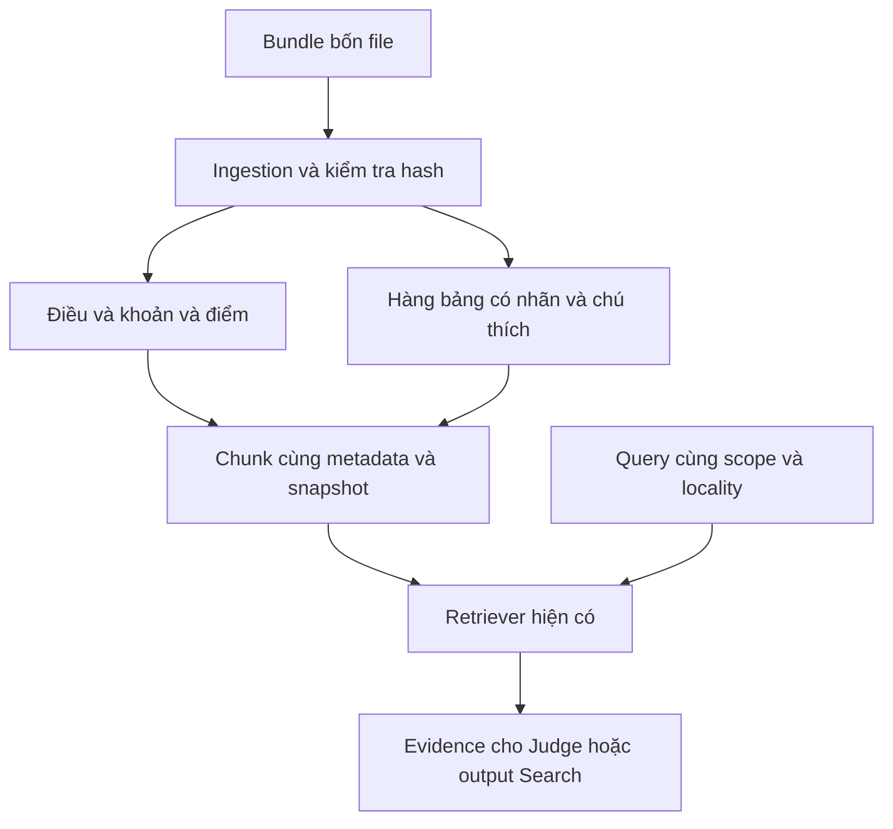

# Thay đổi để dùng bundle dữ liệu của nhóm

Bản cập nhật ngày 19/10/2026. Sửa trực tiếp project cũ và thay cùng archive Tillegal_LangGraph_RAG.zip. Không thay bốn file nguồn của nhóm.

## 1. Vì sao cần đổi logic?

Bản cũ nhận JSONL chunk đã chuẩn bị, article là bắt buộc; không có ingestion. Mẫu mới có metadata tách riêng, HTML giàu cấu trúc, TXT bị làm phẳng bảng và extraction manifest. Vì vậy phải thêm lớp ingestion trước Retriever, cho phụ lục có location riêng, giữ bảng có tên cột và xử lý temporal/locality.



Bảy node và route LangGraph cũ giữ nguyên. Thay đổi tập trung vào đầu vào dữ liệu, retrieval và cách giải thích kết quả theo scope. Không thêm bước con người duyệt mỗi request.

## 2. Vai trò của bốn file

| File | Vai trò | Code sử dụng |
|---|---|---|
| metadata.json | Định danh, số hiệu, title, agency, địa phương, ngày | Map vào Chunk và Evidence |
| content.html | Nguồn nội dung ưu tiên, giữ bảng và điều/khoản/điểm | Parser HTML trong ingest.load_bundle |
| content.txt | Bản text phẳng | Fallback khi không có HTML, không khôi phục cột phụ lục bằng suy đoán |
| content.extraction.json | Method/timestamp/hash của lần extraction | Kiểm tra checksum, lưu report; không phải nội dung luật |

`metadata.documentContent.content` trong mẫu là `$c`, không dùng làm nội dung luật. `provisionTree=null` không ngăn ingestion vì HTML đã có class prov-article/prov-clause/prov-item. Các tên file PDF/DOC trong metadata không có bytes tương ứng, code không coi là đã đọc PDF/DOC.

Không dùng isEffectAllDocument/isOld/reviewed/aiResults để tự xác nhận hiệu lực. `effStatus=CCHL` được giữ ở source_status, không dùng như status có hiệu lực ở mọi thời điểm.

## 3. Mapping metadata

| Mẫu | Trường mới |
|---|---|
| id | document_id UUID |
| docNum | document_number; exact lookup chấp nhận UUID hoặc số hiệu |
| title | title |
| agencyName | agency |
| organization.name/code | locality/locality_code |
| issueDate | issue_date |
| effFrom | effective_from |
| effTo | source_effective_to, đổi sang exclusive effective_to = effTo + 1 ngày |
| effStatus.name | source_status |
| updatedDate | updated_at |
| Hash metadata + file bytes | version_id='snapshot-...' |

`defaultLanguage=VN` là ngôn ngữ; phạm vi quốc gia dùng jurisdiction=VN, địa phương dùng locality riêng. Không đặt jurisdiction='Đà Nẵng'.

Mẫu không có URL gốc đầy đủ: code để url=null. Href tương đối dẫn văn bản khác được giữ trong references với resolved=false; không tự bịa domain và không coi đã đọc nguồn được dẫn chiếu.

## 4. Thay đổi app.py

### Schema Citation / Query / Chunk / Evidence

- Citation.article từ bắt buộc thành optional, thêm location_id/annex/criterion/locality. Citation phải có article hoặc location_id/criterion khi exact match; tránh match toàn bộ văn bản vì thiếu vị trí.
- Query thêm document_id, locality, temporal_scope; mặc định applicable.
- Chunk bổ sung các metadata và provenance; article optional để chunk phụ lục không bị gán thành Điều giả.
- Evidence kế thừa các trường này nên không mất metadata sau retrieval.

Ví dụ tra đúng tiêu chí phụ lục:

```python
Citation(
    citation_id='R1',
    document_id='148/2026/QĐ-UBND',
    annex='1',
    criterion='1.2',
    locality='Đà Nẵng'
)
```

`version_id` là snapshot hash được code nhập dữ liệu tạo, không phải updatedDate và không phải version pháp lý do LLM tự đoán. Cùng số hiệu ở nhiều địa phương cần locality/UUID để phân biệt.

### temporal()

- Trước effective_from hoặc từ effective_to exclusive: invalid theo ngày nguồn cung cấp.
- Trong khoảng ngày, chỉ valid nếu validity_known=true và có effective_from.
- Bundle import mặc định validity_known=false: không có bước xác minh độc lập luật đã bị sửa đổi/bãi bỏ hay chưa, nên trong khoảng là unknown.
- effTo=2030-12-31 được chuyển thành 2031-01-01 exclusive; không loại mất ngày 31/12/2030.

### matches(), same_id(), Retriever.search()

- Exact matching nhận UUID hoặc số hiệu, điều/khoản/điểm hoặc phụ lục/tiêu chí/location_id.
- Citation cả Điều ưu tiên chunk điều đầy đủ, không lấy mỗi heading và bỏ mất các khoản.
- Find_support thêm bộ lọc document_id/locality.
- applicable loại chunk ngoài khoảng ngày; document vẫn lấy để đọc nội dung, giữ temporal_status thực tế.
- BM25 thêm docNum/locality/criterion vào nội dung index; dense encode cả title+content.
- BM25/dense/RRF/reranker và Evidence output vẫn theo kiến trúc cũ.

### query(), refine(), LLM.plan/judge/draft()

- Query và query bổ sung dùng temporal_scope/locality của request; LLM không tự mở scope để né giới hạn.
- Prompt biết số hiệu khác UUID, phụ lục khác Điều, snapshot version không được đoán.
- Nhắc model đọc đúng cột nhóm xã và không coi nguồn dẫn chiếu là đã đọc.

### verify(), finalize()

- applicable giữ chính sách kiểm tra thời gian cũ: temporal unknown chưa VERIFIED, invalid không được kết luận áp dụng.
- document kiểm tra nội dung snapshot, không dùng ngoài khoảng ngày để kết luận nội dung văn bản sai. Report thêm verification_scope=document; response có giới hạn không xác nhận áp dụng.
- warnings hash/URL/metadata đi ra limitations khi có evidence, không bị giấu trong log.
- DemoLLM ở scope document cho đi qua graph để kiểm thử; vẫn chỉ là copy-text fixture.

### run() và CLI

- as_of mặc định ngày hiện tại tại Asia/Ho_Chi_Minh thay ngày cố định demo.
- Thêm --data-dir, --search-only, --temporal-scope, --locality, --document-id.
- --data-dir import bundle trực tiếp; --corpus JSONL cũ vẫn hoạt động.
- --search-only không gọi Query/Judge/Summary/Verify LLM; chỉ test ingestion + retrieval.

## 5. Các hàm mới trong ingest.py

| Hàm | Trách nhiệm |
|---|---|
| expand_table(table) | Mở rộng rowspan/colspan thành grid, giữ ô nguồn |
| load_bundle(folder, strict_hash=False) | Đọc bốn file, kiểm tra, map metadata, parse nội dung và trả chunks/report |
| ingest_root(root, strict_hash=False) | Nhận một bundle hoặc root nhiều bundle; phát hiện duplicate chunk IDs |
| main CLI | Ghi JSONL và report |

Điều được parse theo heading/class; khoản/điểm giữ heading và nội dung cha để đọc đủ ngữ cảnh. Thêm chunk điều đầy đủ phục vụ citation cấp Điều. Không biến dòng dẫn chiếu “Điều 6 Thông tư...” trong bảng thành Điều 6 của Quyết định này.

Mỗi hàng bảng tiêu chí có: tên nhóm tiêu chí, nội dung, ba cột nhóm xã, văn bản đánh giá, chú thích và ghi chú phân nhóm xã. Ô colspan=3 được lặp đúng nội dung cho ba cột; ô rowspan giữ tên tiêu chí qua các hàng. Đây là tuần tự hóa có nhãn của bảng, lưu original_cells và content_representation để phân biệt với trích nguyên văn TXT.

Các footnote [2]/[3]/[4]/[5] được nối vào đúng hàng có marker, đồng thời có chunk footnote riêng. References giữ ở trạng thái chưa resolve, không thực hiện web fetching.

Parser bảng hiện hỗ trợ cấu trúc tiêu chí 7 cột như mẫu; layout khác được báo UNSUPPORTED_TABLE_LAYOUT, không đoán. TXT fallback chỉ parse Điều, báo không còn geometry bảng. Mở rộng adapter theo mẫu mới nếu corpus có nhiều kiểu phụ lục.

## 6. Kết quả đã chạy trên mẫu

61 chunk:
- 3 article headings;
- 9 clauses;
- 5 points;
- 3 full articles;
- 36 criteria table rows;
- 4 footnotes;
- 1 annex note.

Tiêu chí 1.2 được giữ:

```text
Thôn thuộc xã nhóm 1: ≥99%
Thôn thuộc xã nhóm 2: ≥99%
Thôn thuộc xã nhóm 3: ≥98%
```

Đây là nội dung trích từ bundle người dùng, không phải xác minh độc lập quy định pháp luật hiện hành.

File extraction khai báo hai hash không trùng bytes đính kèm hiện tại. Không suy đoán nguyên nhân hoặc tự sửa manifest. Chạy mặc định vẫn tạo corpus có warning; --strict-hash từ chối import. Parser không tự chứng minh metadata và HTML cùng một nguồn đã xác thực; cần crawler lưu source URL và manifest đồng bộ để hoàn thiện provenance.

## 7. Cách chạy

```bash
python -m pip install -r requirements.txt
python ingest.py --input sample_data --output corpus.jsonl

# Đọc văn bản đang chưa hiệu lực theo metadata ngày 19/10/2026.
python app.py --data-dir sample_data --search-only --temporal-scope document --as-of 2026-10-19 --locality "Đà Nẵng" --question "điện sinh hoạt sản xuất xã nhóm 3"

# Kiểm tra nguồn có thể áp dụng tại ngày đó: mẫu này bị loại do chưa đến effFrom.
python app.py --data-dir sample_data --search-only --temporal-scope applicable --as-of 2026-10-19 --question "điện sinh hoạt"

# Bộ kiểm thử.
python -m unittest discover -s tests -v
```

Scope document là lựa chọn nghiệp vụ hiển thị rõ; không được dùng nó để trả lời như thể văn bản đã có hiệu lực. Nếu muốn hỏi tại 2027, trong khoảng metadata vẫn unknown cho đến khi quy trình dữ liệu xác minh hiệu lực.

## 8. Kiểm thử và phần chưa kiểm

26/27 tests qua: 18 tests mới về bundle, bảng, dates, hash, ID, locality, scope, fallback và 9 tests workflow cũ. Có test graph thật chạy trên corpus mẫu với DemoLLM. Dense path cũ dùng fake encoder để kiểm tra đường đi. Chưa gọi model embedding/reranker/LLM thật; chưa đo Recall@k, độ chính xác pháp lý hoặc khả năng chịu tải.

Chưa bổ sung web search, Faith-Search, checkpoint, UI/Go API hoặc sửa draft. Không tự gán URL gốc, không tự biết mapping xã cụ thể sang nhóm 1/2/3 vì ghi chú dẫn tới văn bản khác chưa nhập. Nếu người dùng hỏi xã cụ thể, cần nguồn phân nhóm hoặc dữ kiện bổ sung.
