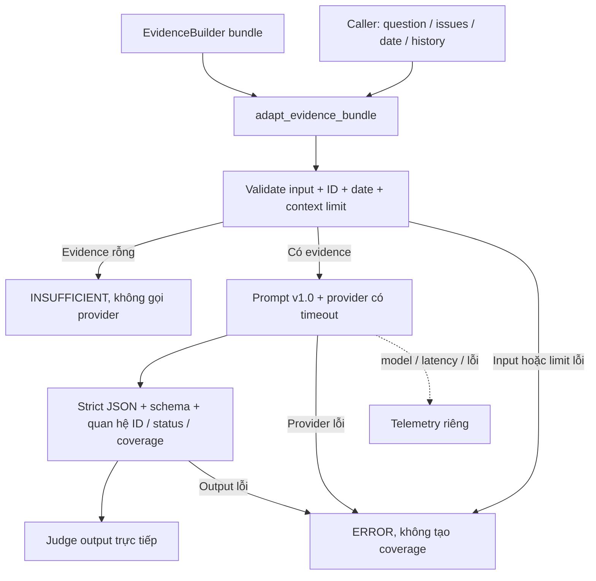

# Judge Agent của Tillegal

Ngày hoàn thành: 01/11/2026. Checkout riêng: `D:\Trang\TilLegal (Legal AI)\Tilligal-judge-agent`.
Nhánh: `feature/judge-agent`. Base: `360aeef1b08fa46514ae846e17f6437ee4855179`, trùng `origin/main` khi fetch.
Không push, merge hoặc sửa remote. Không có API LLM trả phí được gọi trong quá trình thực hiện.

## 1. Vai trò và phạm vi thực hiện

Judge đánh giá độ đầy đủ của **tập evidence trước generation**, theo câu hỏi gốc và các issue do caller/Query cung cấp.
Luồng tích hợp: Query -> Retrieval -> EvidenceBuilder -> adapter -> Judge -> Summary.
Search tìm đoạn nguồn; reranker xếp thứ tự; EvidenceBuilder lắp context; Judge quyết định căn cứ đủ/thiếu;
Summary viết câu trả lời; Verify kiểm tra từng claim-citation sau generation. Module này không triển khai thay các vai trò còn lại.

Đã đọc code thực tế: `basic_rag.py`, `evidence_builder.py`, `retrieval_contracts.py`, `retrieval_runtime.py`,
`rag_generation.py`, `anthropic_provider.py`, `data_contracts.py`, BM25/parser, CLI, requirements và README.
Không tìm thấy AGENTS.md trong repo gốc/checkout hoặc các thư mục cha đã kiểm tra.
Đã đối chiếu PDF pipeline, nhất là mục 5.2, các quy tắc Judge và ngân sách, cùng ghi chú ngữ cảnh đã tiếp nhận.
PDF là thiết kế tham chiếu; JSON minh họa không được dùng làm schema production nguyên xi.

## 2. Luồng thực thi



Adapter không accumulate evidence. Caller tích lũy qua các vòng rồi truyền toàn bộ tập cần đánh giá.
Judge không tự search, sinh issue, retry hoặc nâng ngân sách. Không có output trung gian phải chuyển đổi tiếp.

## 3. File mới và file sửa

| File | Trách nhiệm |
| --- | --- |
| [judge_contracts.py](../ai_core/judge_contracts.py) | Schema input/output; structural validation bằng stdlib; quan hệ giữa các trường; mã lỗi; schema wire Anthropic |
| [judge_adapter.py](../ai_core/judge_adapter.py) | Projection từ EvidenceBuilder v1, bảo toàn nội dung/metadata, phát hiện ID trùng/mâu thuẫn |
| [judge_agent.py](../ai_core/judge_agent.py) | Prompt có version; evaluate; empty fast path; xử lý lỗi; fixture provider; telemetry |
| [judge_cli.py](../ai_core/judge_cli.py) | evaluate/adapt/demo/schemas; JSON stdout; file output tạo mới; live opt-in |
| [anthropic_provider.py](../ai_core/anthropic_provider.py) | Bổ sung `output_schema` tùy chọn; mặc định vẫn dùng schema draft cũ |
| [test_judge.py](../tests/test_judge.py) | Contract, adapter, lỗi, prompt boundary, mock HTTP, CLI |
| [test_judge_integration.py](../tests/test_judge_integration.py) | BM25 thực, EvidenceBuilder, adapter, Judge; regression BasicRAG; pilot smoke |
| [judge_support.py](../tests/judge_support.py), tests/__init__.py | Nguồn giả định và index fixture qua parser/BM25 hiện có |
| [examples/judge](../examples/judge/) | Input, ba output, context, JSON Schemas, 8 case tổng hợp, helper demo và snapshot kết quả thực đã chạy |
| `.gitignore` | Cho phép track đúng các file test Judge; vẫn bỏ qua artifact/runtime |
| `.gitattributes` | `data/indexes/**/index.json -text` để Git không đổi LF thành CRLF làm hỏng hash artifact |
| Tài liệu này | Báo cáo dựa trên implementation và kết quả thực tế |

BasicRAG, retrieval, EvidenceBuilder, parser, dependency manifests và thuật toán index không bị sửa.
Index checkout Windows ban đầu có CRLF làm byte/hash khác manifest. Đã khôi phục **đúng Git blob**,
xác nhận byte count và SHA-256 khớp manifest trước khi ghi; không sửa dữ liệu hoặc cập nhật hash để hợp thức hóa.

## 4. API và hàm chính

| API / chữ ký | Input -> output và nhiệm vụ |
| --- | --- |
| `adapt_evidence_bundle(bundle, *, question, query_plan, as_of_date, search_rounds_completed, query_history, query_text_history=None)` | Bundle thực + ngữ cảnh caller -> dict Judge input đã validate; lỗi adapter raise `JudgeError` |
| `validate_input(value)` | JSON-compatible dict -> bản deepcopy; lỗi raise JudgeError có code |
| `validate_output(value, judge_input)` | Dict output + input đã validate -> bản deepcopy, kiểm tra toàn bộ quan hệ |
| `JudgeLimits(max_input_bytes=100000, max_output_chars=24000)` | Cấu hình giới hạn; invalid config raise JudgeError |
| `judge_messages(value, limits=None)` | Input đã validate -> system/user messages; vượt byte limit thì lỗi, không cắt |
| `JudgeAgent(provider, limits=None).evaluate(value, *, telemetry=None)` | Input Judge -> output chuẩn trực tiếp; lỗi đánh giá được trả dưới status ERROR |
| `JudgeProvider.generate(messages)` | Protocol tương thích provider sẵn có; trả str; timeout thuộc provider |
| `FixtureJudgeProvider(response).generate(messages)` | Replay đúng fixture được cấp; không đánh giá ngữ nghĩa |
| `input_json_schema()`, `output_json_schema()` | Schema đầy đủ để trao đổi; Python bổ sung kiểm tra quan hệ |
| `anthropic_output_schema()` | Schema wire hỗ trợ structured decoding; local validator vẫn kiểm tra schema đầy đủ |
| `judge_cli.main(argv=None)` | Exit 0 cho kết quả đánh giá/adapter thành công; exit 1 cho ERROR; argparse lỗi cú pháp exit 2 |

Ví dụ Python API offline:

```python
from ai_core.judge_agent import JudgeAgent, FixtureJudgeProvider
from ai_core.judge_cli import read_json

telemetry = {}
result = JudgeAgent(FixtureJudgeProvider(read_json("examples/judge/sufficient.json"))).evaluate(
    read_json("examples/judge/input.json"), telemetry=telemetry)
# result chỉ có contract Judge. telemetry giữ model/version/latency/error riêng.
```

## 5. Input đầy đủ và các bổ sung so với PDF

Ví dụ input chuẩn dùng fixture giả định:

```json
{
  "request_id": "req-synthetic",
  "question": "Theo đoạn giả định, nhóm A cần điều kiện gì?",
  "query_plan": {"issues": [{"issue_id": "I1", "text": "Điều kiện cho nhóm A trong ví dụ giả định"}]},
  "evidence": [{"evidence_id": "E1", "content": "GIẢ ĐỊNH: nhóm A cần điều kiện B."}],
  "as_of_date": null,
  "search_rounds_completed": 1,
  "query_history": ["Q1"],
  "query_text_history": ["điều kiện nhóm A"]
}
```

Input còn hỗ trợ **toàn bộ** metadata tùy chọn trong bảng mapping bên dưới. Danh sách trường và kiểu đầy đủ,
required/nullable/limits nằm trong [input.schema.json](../examples/judge/input.schema.json).
[adapter_input.snapshot.json](../examples/judge/adapter_input.snapshot.json) là input đầy đủ xuất từ bundle thực của demo giả định,
có metadata/locator/cờ nguồn/context, không phải placeholder.

Bổ sung so với PDF: `question` bắt buộc; `query_text_history` tùy chọn; `context` tùy chọn;
metadata evidence tùy chọn; `coverage` enum full/partial/none; date có thể null khi caller chưa cung cấp.
`query_plan` của Judge chỉ nhận projection `{issues: [...]}`; caller giữ các phần khác của Query plan ở ngoài,
tránh gửi raw prompt/debug. Không có heuristic tự dựng issue.
Trường tùy chọn vắng mặt nghĩa chưa cung cấp. Adapter biểu diễn metadata không có bằng null;
không suy diễn UNKNOWN thành VERIFIED hoặc fingerprint thành phiên bản pháp luật.
Caller chịu trách nhiệm chọn/nghi rõ giả định thời điểm, module không tự lấy ngày hiện tại.

`query_history` chỉ là ID. `query_text_history` mới chứa nội dung để chống lặp theo casefold/whitespace.
Không dùng Q1 làm truy vấn cũ. Nội dung tương đương ngữ nghĩa nhưng khác chữ chưa được phát hiện bằng code.

## 6. Mapping EvidenceBuilder -> Judge input

Các phép gán giữ nguyên giá trị, không truncate/đổi ID. Deepcopy tách object của caller.
`source_locator` là span cả block, không được diễn giải như span quote chính xác; normalized locator là vị trí trong block chuẩn hóa.
`article_id` và nhãn điều/khoản/điểm là candidate của parser, trạng thái chưa xác minh được giữ nguyên.

| Nguồn | Judge input |
| --- | --- |
| `bundle.request_id` | `request_id` |
| `caller.question` | `question` |
| `caller.query_plan.issues` | `query_plan.issues` |
| `caller.as_of_date` | `as_of_date` |
| `caller.search_rounds_completed` | `search_rounds_completed` |
| `caller.query_history` | `query_history` |
| `caller.query_text_history (default [])` | `query_text_history` |
| `bundle.evidence[].evidence_id` | `evidence[].evidence_id` |
| `bundle.evidence[].quote` | `evidence[].content` |
| `bundle.evidence[].warnings` | `evidence[].warnings` |
| `bundle.evidence[].document_id` | `evidence[].document_id` |
| `bundle.evidence[].document_version_id` | `evidence[].document_version_id` |
| `bundle.evidence[].chunk_id` | `evidence[].chunk_id` |
| `bundle.evidence[].article_id` | `evidence[].article_id` |
| `bundle.evidence[].article_id_status` | `evidence[].article_id_status` |
| `bundle.evidence[].quote_sha256` | `evidence[].quote_sha256` |
| `bundle.evidence[].quote_representation` | `evidence[].quote_representation` |
| `bundle.evidence[].normalized_locator` | `evidence[].normalized_locator` |
| `bundle.evidence[].source_locator` | `evidence[].source_locator` |
| `bundle.evidence[].source_locator_extent` | `evidence[].source_locator_extent` |
| `bundle.evidence[].attachment_status` | `evidence[].attachment_status` |
| `bundle.evidence[].address_status` | `evidence[].address_status` |
| `bundle.evidence[].exact_citation_verified` | `evidence[].exact_citation_verified` |
| `bundle.evidence[].legal_evidence_status` | `evidence[].legal_evidence_status` |
| `bundle.evidence[].context_review_required` | `evidence[].context_review_required` |
| `bundle.evidence[].is_heading` | `evidence[].is_heading` |
| `bundle.evidence[].document.document_number` | `evidence[].document_number` |
| `bundle.evidence[].document.title` | `evidence[].title` |
| `bundle.evidence[].document.source_url` | `evidence[].source_url` |
| `bundle.evidence[].document.issuing_authority` | `evidence[].issuing_authority` |
| `bundle.evidence[].document.source_version` | `evidence[].source_version` |
| `bundle.evidence[].document.effective_from` | `evidence[].effective_from` |
| `bundle.evidence[].document.effective_to` | `evidence[].effective_to` |
| `bundle.evidence[].document.issued_on` | `evidence[].issued_on` |
| `bundle.evidence[].document.temporal_status` | `evidence[].temporal_status` |
| `bundle.evidence[].document.legal_approval` | `evidence[].legal_approval` |
| `bundle.evidence[].document.provenance_status` | `evidence[].provenance_status` |
| `bundle.evidence[].document.rights_status` | `evidence[].rights_status` |
| `bundle.evidence[].document.usage_policy` | `evidence[].usage_policy` |
| `bundle.evidence[].document.effect_status_reported` | `evidence[].effect_status_reported` |
| `bundle.evidence[].document.status_observed_at` | `evidence[].status_observed_at` |
| `bundle.evidence[].document.collected_at` | `evidence[].collected_at` |
| `bundle.evidence[].chunk.article` | `evidence[].article` |
| `bundle.evidence[].chunk.clause` | `evidence[].clause` |
| `bundle.evidence[].chunk.point` | `evidence[].point` |
| `bundle.evidence[].chunk.scope` | `evidence[].scope` |
| `bundle.evidence[].chunk.appendix` | `evidence[].appendix` |
| `bundle.evidence[].chunk.form` | `evidence[].form` |
| `bundle.bundle_id` | `context.bundle_id` |
| `bundle.builder_version` | `context.builder_version` |
| `bundle.index_id` | `context.index_id` |
| `bundle.retrieval_status` | `context.retrieval_status` |
| `bundle.usage_policy` | `context.usage_policy` |
| `bundle.approved_for_legal_verification` | `context.approved_for_legal_verification` |
| `bundle.status` | `context.bundle_status` |
| `bundle.limitations` | `context.limitations` |
| `bundle.groups[].retrieved_chunk_id` | `context.groups[].retrieved_chunk_id` |
| `bundle.groups[].seed_included` | `context.groups[].seed_included` |
| `bundle.groups[].omitted_chunk_ids` | `context.groups[].omitted_chunk_ids` |
| `bundle.groups[].context_sufficiency` | `context.groups[].context_sufficiency` |
| `bundle.groups[].members` | `context.groups[].members` |
| `bundle.groups[].retrieval_cautions` | `context.groups[].retrieval_cautions` |

`question`, `query_plan.issues`, `as_of_date`, `search_rounds_completed`, `query_history`, `query_text_history`
đến từ caller. `bundle.query` có thể là refined query, **không thay question**.
Các trường không gửi LLM: full document/chunk, raw_ref, ancestry tree, raw trace, rank/score/ranking,
query tokens, prompt cũ và debug. Source URL chỉ là dữ liệu, Judge không fetch.
Source/quote identity trong nested document/chunk được kiểm tra khi có; mọi duplicate evidence_id bị từ chối,
duplicate nội dung/metadata khác nhận `CONFLICTING_EVIDENCE_ID`, giống hệt nhận `DUPLICATE_EVIDENCE_ID`.
Đây không thay thế kiểm tra hash nguồn của retrieval/index loader.

## 7. Output và ý nghĩa các trường

Ba output đầy đủ dưới đây minh họa ba tình huống. SUFFICIENT dùng input I1/E1 ở trên;
INSUFFICIENT dùng biến thể phụ thuộc thời điểm được mô tả ngay sau ví dụ; ERROR không kết luận ngữ nghĩa.

```json
{
  "status": "SUFFICIENT",
  "issue_checks": [{"issue_id": "I1", "evidence_ids": ["E1"], "coverage": "full"}],
  "missing_items": [],
  "next_queries": [],
  "usable_evidence_ids": ["E1"],
  "explanation": "E1 nêu điều kiện B của ví dụ giả định.",
  "error_code": null
}
```

```json
{
  "status": "INSUFFICIENT",
  "issue_checks": [{"issue_id": "I1", "evidence_ids": ["E1"], "coverage": "partial"}],
  "missing_items": ["Thiếu căn cứ về thời điểm áp dụng nếu cần kết luận tại ngày cụ thể."],
  "next_queries": [{"text": "thời điểm áp dụng quy tắc B trong ví dụ giả định", "target_issue_id": "I1"}],
  "usable_evidence_ids": ["E1"],
  "explanation": "E1 chỉ cung cấp điều kiện B, chưa có thông tin thời điểm áp dụng.",
  "error_code": null
}
```

Output INSUFFICIENT trên dành cho biến thể input có `as_of_date="2026-10-09"`, question hỏi áp dụng tại ngày đó,
issue I1 tương ứng bao gồm điều kiện và thời điểm. File [insufficient.json](../examples/judge/insufficient.json)
là fixture kỹ thuật khác về ngoại lệ C; các cặp input/output theo tình huống được giữ đầy đủ trong gold seed.
Không coi ba nhãn minh họa là ba đánh giá ngữ nghĩa đã thực hiện trên cùng câu hỏi.

```json
{
  "status": "ERROR",
  "issue_checks": [],
  "missing_items": [],
  "next_queries": [],
  "usable_evidence_ids": [],
  "explanation": "Không hoàn tất đánh giá Judge; xem error_code.",
  "error_code": "PROVIDER_TIMEOUT"
}
```

`full`: đủ căn cứ xử lý issue theo scope của câu hỏi; `partial`: có căn cứ liên quan nhưng còn khoảng trống quyết định;
`none`: không có căn cứ liên quan. none không dẫn ID; partial/full phải có ít nhất một ID.
`usable_evidence_ids`: tập evidence dùng được, không phải nhãn Verify; phải là subset các evidence được dẫn trong checks.
Evidence mâu thuẫn có thể được dẫn để giải thích thiếu, nhưng không cần đưa vào usable.
`missing_items`: các khoảng trống cụ thể, bắt buộc không rỗng khi INSUFFICIENT.
`next_queries`: gợi ý tìm thêm theo target issue, có thể rỗng khi không có hướng mới; caller chọn có chạy hay không.
ERROR không có đánh giá issue hoàn thành nên toàn bộ các danh sách rỗng, không giả tạo coverage=none.

## 8. Checklist, prompt và ranh giới validation

Prompt version: `tillegal-judge-v1.0`, nằm ở `judge_agent.SYSTEM_PROMPT`.
LLM phải đánh giá căn cứ trực tiếp, điều kiện, ngoại lệ **liên quan**, scope, thời gian khi quyết định và mâu thuẫn.
Không bắt mọi câu hỏi tìm mọi ngoại lệ. Không coi score là xác suất; không dùng kiến thức nội tại lấp gap;
không suy diễn hiệu lực hiện hành; không coi thiếu metadata là nguồn sai. Cảnh báo chung chỉ ảnh hưởng sufficiency
khi có tác động quyết định tới yêu cầu. ASSEMBLED/PARTIAL không quyết định nhãn.
Input được JSON-serialize trong user message, policy nằm riêng ở system; question/evidence/metadata đều là untrusted instructions.
Explanation ngắn có evidence IDs khi có căn cứ, không yêu cầu chain-of-thought.

Python kiểm tra schema/blank/limits/calendar, ID duy nhất, membership, đúng một check cho mỗi issue thành công,
coverage-vs-ID, quan hệ status/gaps/queries/error_code, usable membership, trùng query chữ và ERROR shape.
SUFFICIENT đòi mọi issue full, không gaps/queries và mọi evidence được dẫn đều usable.
INSUFFICIENT đòi ít nhất một issue chưa full, có gaps. Output sai bị trả ERROR, không tự sửa hay bỏ ID sai.
Python không chứng minh issue đã đủ về ngữ nghĩa, exception có liên quan, nguồn đúng pháp lý hoặc model kháng injection.
Các phần đó cần đánh giá LLM và human gold.

## 9. Provider, lỗi, giới hạn và telemetry

Tái sử dụng Protocol `generate(messages)` và Anthropic Messages API sẵn có, không thêm dependency Python.
`AnthropicProvider.output_schema` tùy chọn giữ default DRAFT_OUTPUT_SCHEMA cho baseline;
CLI Judge dùng schema wire riêng. Judge còn chặn Anthropic structured config không đúng schema trước network
với `JUDGE_PROVIDER_SCHEMA_MISMATCH`. Nếu tự nối provider mới, caller phải bảo đảm không ép schema draft.

Schema wire bỏ minLength/maxLength/maxItems/uniqueItems vì API không hỗ trợ các constraints này;
schema đầy đủ vẫn nằm trong prompt và được Python kiểm tra **sau** response. Không đổi shape output.
Đã đối chiếu [tài liệu Anthropic structured outputs](https://platform.claude.com/docs/en/build-with-claude/structured-outputs)
ngày 01/11/2026; HTTP mock kiểm tra payload, không thay thế live compatibility test.

| Giới hạn mặc định | Cách xử lý |
| --- | --- |
| Question 10.000 ký tự, <=64 issue, <=128 evidence, mỗi content <=100.000 ký tự | Invalid input schema khi vượt; không cắt |
| Messages 100.000 byte UTF-8 gồm prompt/schema, cấu hình 1.024..120.000 | JUDGE_INPUT_LIMIT trước provider; kiểm tra cả fast path |
| Output 24.000 ký tự, cấu hình 128..65.536 | JUDGE_OUTPUT_LIMIT |
| Anthropic request body 121.000 byte | GENERATION_INPUT_LIMIT từ provider, không đổi thành thiếu evidence |
| Provider output tối đa 2.048 token trong CLI mặc định | Incomplete/refused response trả ERROR; không parse bản cắt |
| File JSON CLI 2.000.000 byte | INPUT_FILE_LIMIT; đọc có bound |
| Timeout socket 30 giây, cấu hình (0,120] | PROVIDER_TIMEOUT; không retry trong Judge |

Byte budget không phải tokenizer budget; provider có thể báo vượt context của model. Không âm thầm cắt evidence.
Socket timeout không phải hard deadline toàn request nếu server nhỏ giọt dữ liệu; custom synchronous provider cũng không
thể bị cưỡng chế cancel trong thread hiện tại. Cần deadline worker/process ngoài tại Orchestrator khi triển khai production.

| Nhóm lỗi | Code tiêu biểu |
| --- | --- |
| Input/schema/calendar/ID | INVALID_INPUT_SCHEMA, INVALID_INPUT_DUPLICATE_ID, INVALID_INPUT_REFERENCE, INVALID_INPUT_LOCATOR, INVALID_INPUT_DATE_RANGE |
| Bundle | INVALID_BUNDLE_SCHEMA, DUPLICATE_EVIDENCE_ID, CONFLICTING_EVIDENCE_ID, BUNDLE_IDENTITY_MISMATCH |
| Output | INVALID_OUTPUT_JSON, INVALID_OUTPUT_SCHEMA, INVALID_OUTPUT_REFERENCE, INVALID_OUTPUT_CONSISTENCY, INVALID_OUTPUT_REPEATED_QUERY |
| Provider/network | PROVIDER_TIMEOUT, PROVIDER_ERROR và code Anthropic hiện có: AUTHENTICATION/RATE_LIMIT/NETWORK/... |
| Config/IO | JUDGE_CONFIGURATION_ERROR, JUDGE_PROVIDER_SCHEMA_MISMATCH, INPUT_READ_ERROR, OUTPUT_ALREADY_EXISTS, CLI_IO_OR_CONFIGURATION_ERROR |
| Demo mặc định | MOCK_NOT_EVALUATED: chưa có semantic assessment, không phải evidence thiếu |

Adapter raise JudgeError khi không thể tạo input hợp lệ; evaluate chuyển lỗi đánh giá thành output ERROR.
Lỗi CLI argument do argparse báo riêng. CLI preflight các output path đã tồn tại trước khi có thể gọi live,
file ghi exclusive, không ghi đè input. Lỗi ghi file và race filesystem vẫn có thể xảy ra sau inference.
Telemetry riêng gồm model, prompt_version, provider_mode, provider_calls, latency_ms, stage, error_code, input_bytes;
allowlist metadata response gồm returned_model/usage/stop_reason/http_status/latency. Không log raw prompt/output,
exception message, key hay raw trace. Caller không tái sử dụng cùng telemetry dict cho nhiều request đồng thời.

## 10. Cài đặt và chạy Windows PowerShell

Tất cả lệnh chạy từ repo root. Module Judge và BM25 không cần torch, embedding hoặc reranker.
Không cần cài thêm package cho Judge/test. requirements của baseline được giữ nguyên.

```powershell
Set-Location 'D:\Trang\TilLegal (Legal AI)\Tilligal-judge-agent'
# Runtime cô lập đã chuẩn bị trong checkout này (Python 3.14.2, Unicode 16).
$py = '.\.tmp\python314\python.exe'
# Với checkout mới, dùng Python 3.14.2 đã cài và thay $py bằng đường dẫn python.exe tương ứng.
& $py -B -m unittest discover -s tests -v

# Replay fixture có chủ đích; không suy luận và không gọi API.
& $py -B -m ai_core.judge_cli evaluate --input examples/judge/input.json --mock-response examples/judge/sufficient.json

# Adapter độc lập từ bundle thực đã chạy và context caller.
& $py -B -m ai_core.judge_cli adapt --bundle outputs/judge-demo-pilot/bundle.json --context examples/judge/context.json

# Pilot BM25, không generation trước Judge; dùng thư mục output mới.
$pilotRun = "outputs/judge-pilot-$([guid]::NewGuid().ToString('N'))"
& $py -B -m ai_core.judge_cli demo --context examples/judge/context.json --artifacts-dir $pilotRun
# Mock mặc định trả ERROR/MOCK_NOT_EVALUATED, exit 1 có chủ đích.

# Demo giả định có response fixture dựng sẵn, hoàn toàn offline.
$fixtureDir = "outputs/judge-fixture-$([guid]::NewGuid().ToString('N'))"
$runDir = "outputs/judge-synthetic-$([guid]::NewGuid().ToString('N'))"
& $py -B -m examples.judge.create_synthetic_demo --output-dir $fixtureDir
& $py -B -m ai_core.judge_cli demo --context examples/judge/synthetic_context.json --index "$fixtureDir/index/manifest.json" --mock-response "$fixtureDir/mock-response.json" --artifacts-dir $runDir

# Xuất lại schema ra thư mục mới.
& $py -B -m ai_core.judge_cli schemas --output-dir "outputs/judge-schema-$([guid]::NewGuid().ToString('N'))"
```

Live là lệnh **chưa chạy**, cần tự bật và cấu hình model có hỗ trợ structured outputs:

```powershell
$env:ANTHROPIC_MODEL = Read-Host 'Model ID Anthropic được cấp quyền'
# Đọc key vào biến môi trường process, không viết key vào lệnh/history hoặc file.
$judgeSecret = Read-Host 'Anthropic API key' -AsSecureString
$env:ANTHROPIC_API_KEY = [System.Net.NetworkCredential]::new('', $judgeSecret).Password
$liveTelemetry = "outputs/judge-live-telemetry-$([guid]::NewGuid().ToString('N')).json"
& $py -B -m ai_core.judge_cli evaluate --input examples/judge/input.json --mode live --allow-live --timeout 30 --max-output-tokens 2048 --telemetry $liveTelemetry
Remove-Item Env:ANTHROPIC_API_KEY
```

Không tự load .env, key không hard-code, không có fallback secret discovery. Thiếu allow-live/key/model thì lỗi config.
Python API live phải tạo `AnthropicProvider.from_environment(allow_live=True, structured_output=True,
output_schema=anthropic_output_schema(), max_tokens=2048)` rồi đưa vào JudgeAgent.

## 11. Các lần chạy thực tế

Python 3.14.2 embeddable chính thức được tải từ python.org vào `.tmp/python314`, không cài hệ thống,
không commit runtime. `_pth` trỏ về checkout tuyệt đối. Python bundled 3.12.14/Unicode 15 không tương thích tokenizer
Unicode 16 đã pin trong pilot; lần thử ban đầu bị chặn đúng bởi integrity. Không sửa TOKENIZER/index để chạy qua.

**Demo pilot thực**: retrieval bằng BM25 hiện có -> EvidenceBuilder -> adapter -> mock Judge; 19 evidence, 2.687 ký tự, ASSEMBLED, 62.270 byte messages trong lần chạy đã lưu,
artifact tại `outputs/judge-demo-pilot/{bundle,input,result,telemetry}.json`.
Không có generation trước Judge. Mock mặc định không đánh giá semantics nên output:

```json
{
  "status": "ERROR",
  "issue_checks": [],
  "missing_items": [],
  "next_queries": [],
  "usable_evidence_ids": [],
  "explanation": "MOCK: chưa đánh giá ngữ nghĩa; chỉ kiểm tra luồng kỹ thuật.",
  "error_code": "MOCK_NOT_EVALUATED"
}
```

**Demo giả định**: `outputs/judge-demo-synthetic` có input/result/telemetry; 3 evidence, tổng 128 ký tự,
bundle ASSEMBLED. Response fixture dựng sẵn trả SUFFICIENT, full I1 và 3 evidence IDs giữ nguyên qua adapter.
Đây là replay minh họa routing, không phải LLM chứng minh đủ evidence.
[adapter_input.snapshot.json](../examples/judge/adapter_input.snapshot.json),
[demo_result.snapshot.json](../examples/judge/demo_result.snapshot.json),
[run_record.json](../examples/judge/run_record.json) lưu snapshot và số liệu đã chạy để review ngay cả khi outputs bị bỏ qua bởi Git.

## 12. Kiểm thử kỹ thuật và đánh giá ngữ nghĩa

Kết quả cuối trên Python 3.14.2: **48 tests Python chạy, 48 đạt, 0 failure, 0 error, 0 skipped.**
Lệnh: `& $py -B -m unittest discover -s tests -v`.
Log đầy đủ và bản JSON machine-readable tại `examples/judge/test_run.txt` và `examples/judge/test_result.json`.

Bao phủ: giữ ID/content/metadata/warnings/locator, không mutate, duplicate/conflict/reference lỗi;
đủ/thiếu một trong nhiều issue; replay thiếu điều kiện/ngoại lệ, không liên quan, mâu thuẫn, temporal unknown;
empty fast path; JSON duplicate keys/malformed/schema/status sai; provider timeout/error; prompt-injection boundary;
ASSEMBLED/PARTIAL không quyết định sufficiency; wire schema không lẫn draft; default live opt-in;
CLI; BM25/Builder/adapter/Judge; BasicRAG regression; smoke corpus pilot.

Fixture test chỉ chứng minh contract, xử lý lỗi, truyền dữ liệu và nhánh; **không chứng minh nhãn ngữ nghĩa đúng**.
Injection test chỉ chứng minh nội dung ở user payload, system policy vẫn có và output validator hoạt động.
Không tuyên bố model kháng injection dựa trên fake response.
Chưa chạy live, chưa đo legal accuracy/Macro-F1/sufficiency precision/recall của model.

Tám ví dụ seed tại [synthetic_gold_seed.json](../examples/judge/synthetic_gold_seed.json) có input, expected_output,
case_id, cờ synthetic_not_law và label_source=author_seed_not_human_gold; toàn bộ quy tắc là giả định.
Để thành human gold: thu request/issue/evidence thật có provenance, chia dev/test theo tài liệu và thời gian,
nhờ ít nhất hai người hiểu luật gán sufficiency/coverage/gaps độc lập, adjudicate bất đồng;
ghim corpus/model/prompt/date, thêm ca thiếu ngoại lệ, mâu thuẫn, lỗi nguồn, thời gian, injection.
Đo precision của SUFFICIENT (đặc biệt false sufficient), recall thiếu/Macro-F1, từng issue, invalid-output rate,
latency/chi phí, agreement. Không dùng nhãn fixture của chính model làm gold.

## 13. Nối vào LangGraph và giữ baseline

Không thêm dependency LangGraph hoặc vòng lặp đầy đủ trong task này. Node tương lai có thể dùng:

```python
def judge_node(state):
    telemetry = {}
    result = judge_agent.evaluate(state["judge_input"], telemetry=telemetry)
    return {"judge_result": result, "judge_telemetry": telemetry}

def route_after_judge(state):
    status = state["judge_result"]["status"]
    if status == "SUFFICIENT":
        return "summary"
    if status == "ERROR":
        return "retry_judge" if state["judge_retries_remaining"] > 0 else "finish_error"
    if state["search_budget_remaining"] > 0 and state["has_progress"]:
        return "query_refine"
    return "finish_with_gaps"
```

Đây là hướng nối, chưa phải graph đã chạy. Orchestrator tự định nghĩa has_progress theo query/evidence mới,
đếm budget/retry bằng code, giữ câu hỏi gốc, accumulate/de-duplicate trước adapter, truyền issues thật từ Query,
và lưu đầy đủ gaps khi hết lượt. SUFFICIENT sang Summary vẫn cần Verify sau generation.
Không gọi Judge bằng `BasicRAG.answer()` vì phương thức đó đã generation; demo Judge dùng retrieval/Builder trực tiếp.
Baseline BasicRAG giữ nguyên để so sánh cùng corpus/model/budget, regression đã chạy bằng MockProvider baseline.

## 14. Hạn chế và quyết định cần nhóm chốt

- Chưa xác minh live Anthropic với account/model cụ thể; chưa có bộ human gold tiếng Việt hoặc kết luận độ chính xác pháp lý.
- Không triển khai Query/Summary/Verify, accumulation Orchestrator, LangGraph loop, web search hoặc cập nhật pháp luật.
- Giới hạn byte thay cho token preflight; không hard deadline toàn request, không semantic repeat detection.
- Chưa validate claim-citation, hash evidence độc lập hay hiệu lực pháp lý; source flags được bảo toàn chứ không nâng cấp.
- API plain dict/stdlib theo convention repo, không thêm Pydantic. JSON Schema structural và Python relational validation phải dùng cùng nhau.
- ERROR shape rỗng, query_text_history, metadata projection/context và coverage enum là các bổ sung được tài liệu hóa so với PDF.
- Cần nhóm chốt rubric đủ evidence theo loại yêu cầu, nguồn/hiệu lực được tin cậy, model/prompt budget, retention telemetry,
  retry/deadline/concurrency và tiêu chí tiến triển. Việc Judge xuất hiện trong mode verify của toàn hệ thống vẫn là quyết định tích hợp riêng.

## Vị trí định nghĩa trong code cuối

- `ai_core/judge_contracts.py:13` - `JudgeError`.
- `ai_core/judge_contracts.py:19` - `text`.
- `ai_core/judge_contracts.py:24` - `array`.
- `ai_core/judge_contracts.py:31` - `obj`.
- `ai_core/judge_contracts.py:97` - `_shape`.
- `ai_core/judge_contracts.py:137` - `query_key`.
- `ai_core/judge_contracts.py:142` - `_unique_ids`.
- `ai_core/judge_contracts.py:149` - `validate_input`.
- `ai_core/judge_contracts.py:174` - `validate_output`.
- `ai_core/judge_contracts.py:217` - `error_result`.
- `ai_core/judge_contracts.py:223` - `input_json_schema`.
- `ai_core/judge_contracts.py:228` - `output_json_schema`.
- `ai_core/judge_contracts.py:233` - `anthropic_output_schema`.
- `ai_core/judge_adapter.py:21` - `adapt_evidence_bundle`.
- `ai_core/judge_agent.py:46` - `JudgeProvider`.
- `ai_core/judge_agent.py:54` - `JudgeLimits`.
- `ai_core/judge_agent.py:64` - `judge_messages`.
- `ai_core/judge_agent.py:74` - `FixtureJudgeProvider`.
- `ai_core/judge_agent.py:86` - `JudgeAgent`.
- `ai_core/judge_cli.py:17` - `read_json`.
- `ai_core/judge_cli.py:32` - `write_json`.
- `ai_core/judge_cli.py:38` - `configured_provider`.
- `ai_core/judge_cli.py:63` - `_context_payload`.
- `ai_core/judge_cli.py:72` - `main`.
- `ai_core/anthropic_provider.py:19` - `AnthropicProvider`.
- `ai_core/chatgpt_provider.py:20` - `chatgpt_command`.
- `ai_core/chatgpt_provider.py:57` - `ChatGPTProvider`.

## Bổ sung provider ChatGPT

Provider ChatGPT dùng Sign in with ChatGPT đã được bổ sung, không cần API key Anthropic.
Hướng dẫn đăng nhập, chọn model, chạy live và xử lý lỗi nằm trong [judge_chatgpt_live.md](judge_chatgpt_live.md).
Chạy `judge-chatgpt.cmd Login`, `judge-chatgpt.cmd Models`, rồi `judge-chatgpt.cmd Live` từ PowerShell.

## Provider OpenAI API cho backend

Đã bổ sung đường server-side `--provider openai`, dùng OPENAI_API_KEY/OPENAI_MODEL, không cần phiên ChatGPT/Node.
Báo cáo và ví dụ backend: [judge_openai_api.md](judge_openai_api.md).
Kiểm thử lần tích hợp này: 69 Python + 21 Node regression đạt, chưa gọi OpenAI API live.


## Bổ sung Gemini API (01/11/2026)

Đã thêm provider Gemini độc lập qua SDK google-genai, cấu hình server GEMINI_API_KEY/GEMINI_MODEL, CLI --provider gemini; giữ schema/checklist/adapter và provider cũ. Chi tiết implementation, backend API, lệnh PowerShell, quota/chính sách dữ liệu và 86 Python + 21 Node test offline tại [Judge Gemini API](judge_gemini_api.md). Chưa chạy live; không triển khai HTTP server hoặc vòng lặp LangGraph trong phần bổ sung này.
